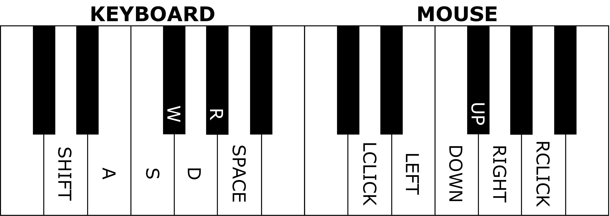

# MIDIator: The MIDI-Input Mediator

MIDIator turns a MIDI device into a Windows keyboard and mouse. Plug in a MIDI
keyboard, name it in a config file, and play.

It ships with a preset for **Genshin Impact's 21-key instrument layout**, so you
can play the Windsong Lyre, Floral Zither, Vintage Lyre or any other playable
instrument from a real MIDI piano.

**Demo** — [img/demo.mp4](img/demo.mp4) shows the original project playing an FPS
with a MIDI keyboard. GitHub renders it inline on the
[repository page](https://github.com/ajstensland/MIDIator); locally, open the
file directly.

- [Quickstart](#quickstart)
- [Genshin Impact preset](#genshin-impact-preset)
- [Configuration](#configuration)
- [Generic mode](#generic-mode)
- [Command line](#command-line)
- [Troubleshooting](#troubleshooting)
- [Development](#development)

## Quickstart

Requires Windows and Python 3.12 or newer. [uv](https://docs.astral.sh/uv/)
handles the interpreter and dependencies.

```bash
git clone <this repo> MIDIator
cd MIDIator

# Install into a project-local .venv
uv sync

# Write a commented starter config
uv run midiator --init

# See what Windows calls your keyboard
uv run midiator --list-devices
```

Then edit `midiator.toml` and set `device` to part of your keyboard's name, open
an instrument in Genshin, and run:

```bash
uv run midiator
```

Keep the game in the foreground after starting MIDIator. If Genshin runs as
administrator, start your terminal as administrator too, so Windows accepts the
synthetic input.

### Running from a double-click

`run_as_admin.bat` does the elevation for you: double-click it and it requests
administrator rights, then starts MIDIator.

Windows asks for permission through a User Account Control prompt. That prompt
is drawn on the **secure desktop**, so the screen may dim or flash, and the
dialog can end up behind other windows — check the taskbar or press `Alt+Tab` if
you do not see it. Declining it means MIDIator never starts, and the script says
so.

If the prompt is a nuisance, make a permanent elevated shortcut instead. This is
the more reliable of the two, because Windows applies the elevation before the
script runs and never shows a per-launch dialog:

1. Right-click `run_as_admin.bat` → **Show more options** → **Send to** →
   **Desktop (create shortcut)**. On Windows 10, **Send to** is on the first
   menu.
2. Right-click the new shortcut → **Properties** → **Shortcut** tab →
   **Advanced…** → tick **Run as administrator**.
3. Launch MIDIator from that shortcut from now on.

Either way you get a console window showing the log. Leave it open while you
play; closing it stops MIDIator.

## Genshin Impact preset

### The layout

Every playable Genshin instrument offers the same 21 naturals across three
octaves. There are no black keys.

| Register | MIDI pitches | Keys |
| --- | --- | --- |
| Low | C3–B3 (48–59) | `Z X C V B N M` |
| Middle | C4–B4 (60–71) | `A S D F G H J` |
| High | C5–B5 (72–83) | `Q W E R T Y U` |

The three rows sit on the keyboard where you would expect them: the low register
on the bottom letter row, the middle on the home row, and the high on the top row.

Because the game has no black keys, an arbitrary MIDI performance cannot be
played literally. MIDIator fixes this in two steps, governed by two settings:

1. **Out-of-range notes** are moved by whole octaves until they land between C3
   and B5 (`out_of_range = "fold"`, the default). Set it to `"skip"` to drop
   them instead.
2. **Black keys** are moved onto a neighbouring white key, preferring the lower
   one (`accidental = "snap"`, the default). Set it to `"skip"` to drop them
   instead, which is more faithful but loses notes.

Folding clamps towards the register edges rather than always jumping to the same
octave: C6 becomes C5, but B6 becomes B5 and C2 becomes C3. That keeps the
melody's contour as close to the original as the instrument allows.

Every note is logged as it arrives, so you can see exactly what happened:

```
  C4 ->   C4 -> key A
 C#4 ->   C4 -> key A (snapped)
  C6 ->   C5 -> key Q (folded)
  C2 ->   C3 -> key Z (folded)
```

### Transposing

Most MIDI files are written in keys that need black notes. Shifting the whole
performance by a few semitones often makes it mostly white keys, and `transpose`
does that:

```toml
[genshin]
transpose = -2   # play everything two semitones lower
```

`transpose` is useful together with `accidental = "skip"`, where the number of
playable notes actually depends on it. With `accidental = "snap"` every note
finds a key no matter what, so transposing only changes which key it is.

To automate it, set `auto_transpose = true`: MIDIator watches your first twelve
notes and picks the shift that plays the most of them.

You can also audition a mapping without sending any input:

```bash
uv run midiator --preview 60 61 62
```

## Configuration

MIDIator reads `midiator.toml` from the working directory, falling back to the
project root. Every setting is optional, and `midiator.example.toml` documents
all of them.

```toml
preset = "genshin"   # or "generic"
verbose = true       # log every note

[midi]
device = "Casio"     # part of the device name, case-insensitive
substring = true     # false requires an exact name match
channel = 0          # 0-15, or comment out for all channels
reconnect = true     # wait for the device and reopen it after a disconnect
retry_seconds = 2.0  # how often to look for the device
watchdog_seconds = 30.0

[windows]
key_mode = "scancode"        # "scancode" for games, "virtualkey" otherwise
mouse_sensitivity = 4        # pixels per tick, generic mode only
mouse_refresh = 0.005        # seconds between mouse updates

[genshin]
transpose = 0                # -48 to 48 semitones
accidental = "snap"          # "snap" or "skip"
out_of_range = "fold"        # "fold" or "skip"
auto_transpose = false
```

### Why `key_mode` matters

Windows accepts two ways of describing a key, and they are not interchangeable:

- `"scancode"` (default) sets `KEYEVENTF_SCANCODE` and passes a **scan code**,
  which identifies the physical key position. Games that read raw input or
  DirectInput expect this.
- `"virtualkey"` passes a **virtual-key code** in `wVk`, which is what ordinary
  Win32 applications expect.

The original MIDIator wrote scan codes into the virtual-key field, which is why
it was unreliable in games. If your target application ignores `"scancode"`,
switch to `"virtualkey"`.

## Hot-plugging

The MIDI device does not have to be connected when MIDIator starts, and
unplugging it mid-session is safe.

- **No device yet?** MIDIator keeps running and retries every
  `retry_seconds`, printing what it is waiting for. Plug the keyboard in and
  playing starts immediately, with no restart.
- **Device unplugged while playing?** Every held key is released straight away,
  so nothing gets stuck down in the game, and MIDIator then waits for the device
  to come back and reopens it automatically.

```toml
[midi]
reconnect = true         # set false to exit instead of waiting
retry_seconds = 2.0      # how often to look for the device
watchdog_seconds = 30.0  # silence before the port is checked for liveness
```

Two mechanisms watch for a disconnect, because a unplug is not always reported:

1. Windows normally makes the port raise as soon as the device goes away, and
   MIDIator notices immediately.
2. If WinMM instead goes quiet without saying anything, MIDIator only reacts
   after `watchdog_seconds` without a single MIDI message. There is no way to
   tell that silence apart from simply not playing, so keep this value longer
   than your longest pause between notes.

Reads happen on a background thread, because `mido`'s blocking iterator cannot
be interrupted: a dead port could otherwise block the main loop forever. Raw
input is never replayed, so notes pressed while the keyboard was unplugged are
not sent when it returns.

Use `--no-reconnect` to get the old exit-on-failure behaviour, which is handy in
scripts.

## Generic mode

Set `preset = "generic"` to bind notes to keys and mouse actions by hand. This
is the original MIDIator behaviour, useful for using a piano as a general input
device. The diagram below is the upstream project's original default binds for
this mode:



```toml
preset = "generic"

[binds.keys]
42 = "W"       # F#2 -> W
45 = "SPACE"   # A2  -> space

[binds.mouse_buttons]
50 = "LEFT"    # D3 -> left click, held for as long as the note is

[binds.mouse_movement]
52 = "LEFT"    # hold E3 to move the cursor left
```

Notes are MIDI numbers (60 is C4). Key names come from
[`KEYBOARD`](src/midiator/windows/keyboard.py) — letters, `SPACE`,
`LSHIFT`, `F1`, `UP`, `NUMPAD0` and so on. A `KEY_` prefix is accepted, so
`"KEY_W"` and `"W"` are the same key.

Mouse buttons are named by direction only: `LEFT`, `RIGHT`, `MIDDLE` or `X`.
MIDIator presses the button on note-on and releases it on note-off, so there is
no way to accidentally write only half of a click. Writing a flag name such as
`LEFT_DOWN` is an error, and the message says what to write instead.

Mouse movement binds are directions (`LEFT`, `RIGHT`, `UP`, `DOWN`). Holding
several at once adds up, and releasing one keeps the others moving.

## Command line

```
uv run midiator [options]

  -c, --config PATH        config file to use
      --init               write a starter midiator.toml and exit
      --list-devices       list MIDI inputs and exit
      --preset NAME        override preset ("genshin" or "generic")
      --device NAME        override the MIDI device
      --channel N          override the MIDI channel
      --transpose N        override the Genshin transpose
      --key-mode MODE      override "scancode" or "virtualkey"
      --no-reconnect       exit instead of waiting for the MIDI device
      --preview NOTE ...   print the mapping for MIDI notes and exit
      --dry-run            log input events instead of sending them
  -q, --quiet              only log warnings and errors
  -v, --verbose            log debug detail
```

`--dry-run` is the safe way to check a mapping: it exercises the whole
translation path and prints the exact scan codes, but sends nothing.

## Troubleshooting

**"does not identify an active or valid MIDI device"**
Run `--list-devices` and check the name. Keyboard names can differ from what
Windows shows in Device Manager; use the name MIDIator prints.

**The device is in use by another process**
Close other MIDI software. A DAW holding the port exclusively will block
MIDIator.

**Nothing happens in the game**
Check that the game is in the foreground and its instrument interface is open.
If the game runs as administrator, run your terminal as administrator as well.
If key presses still do not register, try `key_mode = "virtualkey"`.

**Notes are wrong or missing**
Run with `verbose = true` (the default) and watch the log. Notes reported as
`skipped` have no key under `accidental = "skip"`; switch to `"snap"` or adjust
`transpose`.

**Chords drop notes**
Genshin itself limits how fast it accepts input. Dense material is better played
more slowly, or with fewer simultaneous notes.

**It keeps saying it is waiting for the device**
The name in `device` does not match any port. The message lists every input
Windows reports, so copy one from there. Run `--list-devices` to see the same
list. Use `--no-reconnect` if you would rather it fail immediately.

## Development

```bash
uv sync                     # create .venv and install everything
uv run pytest               # full suite; sends no real input
uv run ruff format .        # formatting
uv run ruff check .         # linting
uv run ty check .           # type checking
```

The tests inject recording senders and fake MIDI ports, so they never touch the
real desktop or the sound card. The MIDI backend is exercised only through
`--list-devices`.

`tests/test_hotplug.py` covers waiting for a device, disconnects, the silent-port
watchdog and reconnection. The fake port wakes a blocked reader the way a real
driver notification does, so those tests are not timing-dependent.

Layout:

| Path | Purpose |
| --- | --- |
| `src/midiator/__main__.py` | Command-line interface. |
| `src/midiator/config.py` | TOML loading, validation and rendering. |
| `src/midiator/engine.py` | Note-to-input dispatch, mouse vector, main loop. |
| `src/midiator/notes.py` | The 21-key layout, folding and accidental snapping. |
| `src/midiator/midi.py` | Device discovery, hot-plug supervision, message normalisation. |
| `src/midiator/windows/keyboard.py` | Key tables and `SendInput` keyboard events. |
| `src/midiator/windows/mouse.py` | Mouse flags and `SendInput` mouse events. |

## Prior work and licence

MIDIator was created by [ajstensland](https://github.com/ajstensland/MIDIator)
and released under the MIT licence, which this fork keeps. The Genshin key
layout matches the one used by
[GenshinMusic](https://github.com/goldlzh/GenshinMusic). The `SendInput`
structures are adapted from Nicholas Brochu's Serpent.AI work; see the header of
`src/midiator/windows/keyboard.py`.

This is an input automation tool, not an official Genshin Impact feature. Use it
within the game's rules and at your own discretion.
